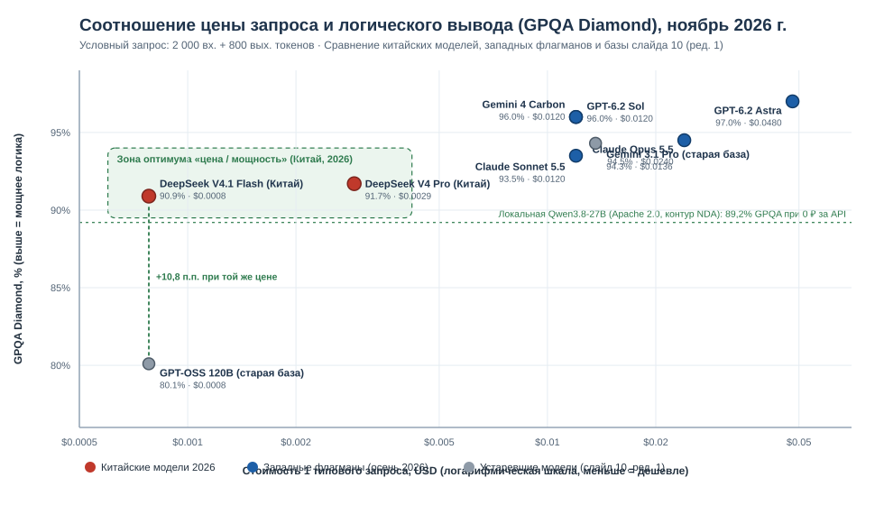
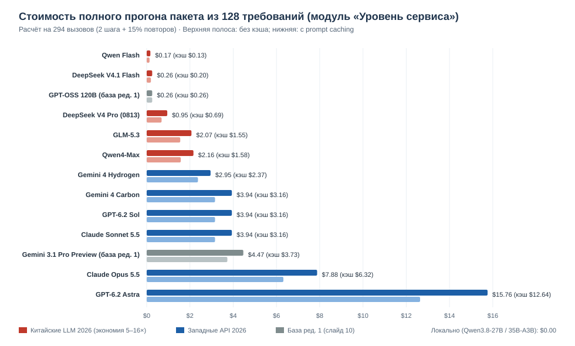

# Исследование и ТЭО актуальных LLM-моделей (ноябрь 2026 г.) для генерации тест-кейсов Test IT

**Проект:** НИР НИУ «МЭИ» × ООО «АшанТех» — *Автоматизированная подготовка тест-кейсов по технической документации с помощью ИИ (LLM)*  
**Дата актуализации:** 27 ноября 2026 г.  
**Назначение репозитория:** открытое сравнительное исследование современных языковых моделей конца 2026 года, заменяющее устаревший стек первого варианта 10-го слайда (`GPT-OSS 120B`, `Gemini 3.1 Pro Preview`, `Gemma 4B`) на актуальные облачные и локальные модели (включая высокоэффективные китайские LLM).

> **Конфиденциальность (NDA):** данный репозиторий не содержит исходных ТЗ, ролевых файлов, внутренних документов или данных ООО «АшанТех». Все расчёты выполнены на обезличенных параметрах нагрузки (128 требований, 2-шаговый конвейер, 18 столбцов шаблона Test IT).

---

## 1. Почему понадобилось обновление стека со слайда 10

В первоначальной редакции исследования (слайд 10) рассматривались модели образца 2025 – начала 2026 гг.:
1. **`GPT-OSS 120B`** (08.2025) — логика `GPQA Diamond 80,1%`, `SWE-bench Verified 62,4%`, тариф `$0,15 / $0,60` за 1 млн токенов;
2. **`Gemini 3.1 Pro Preview`** (02.2026) — `GPQA Diamond 94,3%`, высокий тариф `$2,00 / $12,00`;
3. **`Gemma 4B`** в качестве локальной офлайн-модели в контуре NDA — малый размер (4 млрд параметров) ограничивал стабильность строгого заполнения 18 столбцов Excel Test IT и анализа сложных бизнес-правил.

К концу ноября 2026 года рынок LLM качественно изменился:
- **Стандарт контекста вырос до 1 млн токенов** (против 128K ранее), что позволяет подавать связанные разделы ТЗ (фильтры, графики, ролевую матрицу) целиком без агрессивной нарезки.
- **Новые китайские модели (`DeepSeek V4.1 Flash`, `DeepSeek V4 Pro`, `Qwen4-Max`, `GLM-5.3`) сравнялись по логике с топ-уровнем, но стоят в 5–16 раз дешевле западных флагманов** (`Gemini 4 Carbon`, `GPT-6.2 Sol/Astra`, `Claude Opus/Sonnet 5.5`).
- **Локальные китайские open-weights модели (`Qwen3.8-27B` под Apache 2.0, `Qwen3.6-35B-A3B` MoE с 3B активных параметров)** достигли `89,2%` на `GPQA Diamond` и `>91%` на `IFEval`, превосходя прошлогоднюю облачную `GPT-OSS 120B` при **0 ₽ затрат на API** и полном отсутствии передачи данных во внешнюю сеть.

---

## 2. Сводная таблица кандидатов (ноябрь 2026 г.)

| Категория | Модель | Лицензия / доступ | Контекст | Подтверждённые показатели | Тариф за 1 млн ток. (вх. / вых. / кэш) | Запрос (2K+800) | Пакет 128 ТЗ (с кэшем) |
|---|---|---|---|---|---|---|---|
| **Китай · Облако (основная)** | **DeepSeek V4.1 Flash** | MIT (API + Open Weights) | 1M | GPQA **90,9%**, DeepSWE v1.1 **74,2%**, Terminal-Bench 2.1 **90,6%** | **$0,15 / $0,60** (кэш **$0,003**)* | **$0,00078** | **$0,26** (с кэшем **$0,20**) |
| **Китай · Облако (мощная)** | **DeepSeek V4 Pro (0813)** | MIT (API + Open Weights) | 1M | GPQA **91,7–92,8%**, SWE-bench Verified **77,6%+** | **$0,66 / $1,98** (кэш **$0,022**)* | **$0,00290** | **$0,95** (с кэшем **$0,69**) |
| **Китай · Облако (агенты/зрение)** | **Qwen4-Max** | Проприетарная API | 1M | DeepSWE **75,7%**, APEX-Agents v1.1 **72,1%** | **$1,50 / $4,50** (кэш **$0,075**) | **$0,00660** | **$2,16** (с кэшем **$1,58**) |
| **Китай · Облако (код/агенты)** | **GLM-5.3** | GLM-5.3 License | 1M | Terminal-Bench 2.1 **88,0%**, DeepSWE v1.1 **67,0%** | **$1,40 / $4,40** | **$0,00632** | **$2,07** (с кэшем **$1,55**) |
| **Китай · Сверхбюджет** | **Qwen Flash** | Проприетарная API | 1M (база 256K) | Быстрый бюджетный класс (Alibaba Cloud) | **$0,10 / $0,40** | **$0,00052** | **$0,17** (с кэшем **$0,13**) |
| **США · Флагман (Google)** | **Gemini 4 Carbon** | Проприетарная API | 1M | GPQA **95,5–96,8%**, Terminal-Bench 4.0 **65,2%** | **$2,00 / $10,00** (с 01.12: $4/$20) | **$0,01200** | **$3,94** (с кэшем **$3,16**) |
| **США · Рабочий стандарт (OpenAI)** | **GPT-6.2 Sol** | Проприетарная API | 1,05M | GPQA **~96,0%**, `strict: true` JSON Schema | **$2,00 / $10,00** (кэш $0,10) | **$0,01200** | **$3,94** (с кэшем **$3,16**) |
| **США · Рабочий стандарт (Anthropic)** | **Claude Sonnet 5.5** | Проприетарная API | 1M | GPQA **93–95%**, Terminal-Bench 4.0 **70,6%** | **$2,00 / $10,00** (кэш $0,10) | **$0,01200** | **$3,94** (с кэшем **$3,16**) |
| **США · Топ-флагман (OpenAI)** | **GPT-6.2 Astra** | Проприетарная API | 1,05M | GPQA **97,0%**, FrontierCode 2.0 **44,2%** | **$8,00 / $40,00** (кэш $0,40) | **$0,04800** | **$15,76** (с кэшем **$12,64**) |
| **США · Топ-флагман (Anthropic)** | **Claude Opus 5.5** | Проприетарная API | 1M | GPQA **93–95%**, FrontierCode 2.0 **45,5%** | **$4,00 / $20,00** (кэш $0,20) | **$0,02400** | **$7,88** (с кэшем **$6,32**) |
| **Китай · Локально NDA** | **Qwen3.8-27B** | **Apache 2.0** (HF) | 262K | GPQA **89,2%**, LiveCodeBench v6 **90,3%**, IFEval **>91%** | **0 ₽ за API** (1 GPU 24–48 ГБ) | **$0,00000** | **$0,00** (офлайн) |
| **Китай · Локально NDA (MoE)** | **Qwen3.6-35B-A3B** | Открытая лицензия | 262K–1M | SWE-bench Verified **73,4%** (всего 3B актив. парам.) | **0 ₽ за API** (1 GPU 24 ГБ) | **$0,00000** | **$0,00** (офлайн) |
| *Ретро-база (слайд 10, ред. 1)* | *GPT-OSS 120B (2025)* | *Apache 2.0* | *128K* | *GPQA 80,1%, SWE-bench 62,4%* | *$0,15 / $0,60* | *$0,00078* | *$0,26* |

*\*Примечание: для DeepSeek приведены off-peak тарифы (50% от peak-тарифа, действующего 4+4 часа в будни по UTC); даже в peak-окно `DeepSeek V4.1 Flash` (`$0,30/$1,20`) в 6–13 раз дешевле западных моделей аналогичного класса.*

---

## 3. Визуализация: «цена — качество» и стоимость полного прогона

### 3.1. Сдвиг границы эффективности (ноябрь 2026 г.)

### 3.2. Затраты на полный цикл генерации (128 требований, ~294 вызова с учётом 15% повторов)

---

## 4. Главные выводы для прототипа НИР («АшанТех»)

1. **Прорыв в качестве при сохранении минимального бюджета:** при той же цене `$0,15 / $0,60`, что стоила старая `GPT-OSS 120B`, новая китайская **`DeepSeek V4.1 Flash`** поднимает логический вывод `GPQA Diamond` с **80,1% до 90,9%** (+10,8 п.п.), расширяет контекст с 128K до **1 млн токенов** и поддерживает агрессивное кэширование системного промпта (`$0,003` за 1 млн токенов — весь пакет из 128 требований обходится около **$0,20**).
2. **Экономия в 5–16 раз относительно западных лидеров:** **`DeepSeek V4 Pro`** (`$0,66 / $1,98`) и **`Qwen4-Max`** (`$1,50 / $4,50`) закрывают сложные многотабличные требования за **$0,69–$1,58** на весь модуль вместо **$3,16–$12,64** на `GPT-6.2 Sol/Astra`, `Gemini 4 Carbon` или `Claude 5.5`.
3. **Замена локальной модели для закрытого NDA-контура:** вместо слабой `Gemma 4B` целевым безопасным решением внутри сети ООО «АшанТех» становятся открытые китайские модели **`Qwen/Qwen3.8-27B`** (Apache 2.0, `GPQA 89,2%`, `IFEval >91%`) и **`Qwen/Qwen3.6-35B-A3B`** (3B активных параметров на 1 GPU 24 ГБ, `SWE-bench 73,4%`), а на серверном кластере — self-hosted **`DeepSeek V4.1 Flash`** (MIT).

---

## 5. Структура репозитория

- [`data/model_candidates_2026.csv`](data/model_candidates_2026.csv) — полный реестр технических характеристик, лицензий и тарифов 17 моделей (ноябрь 2026 г. + ретро-база).
- [`data/benchmark_results_2026.csv`](data/benchmark_results_2026.csv) — сводка опубликованных бенчмарков (`GPQA Diamond`, `SWE-bench`, `DeepSWE`, `Terminal-Bench`, `LiveCodeBench`, `IFEval`) с оговорками сопоставимости.
- [`docs/research/recommendation.md`](docs/research/recommendation.md) — архитектурные рекомендации по 4 контурам применения для `testgen`.
- [`docs/research/price_quality.md`](docs/research/price_quality.md) — математическая модель расчёта стоимости, эффект кэширования и анализ Парето-эффективности.
- [`docs/research/api_terms_and_nda.md`](docs/research/api_terms_and_nda.md) — анализ `Structured Output` (`json_schema` под 18 столбцов Test IT), лицензий весов и требований ИБ/NDA.
- [`scripts/generate_charts_and_verify.py`](scripts/generate_charts_and_verify.py) — скрипт пересчёта таблиц, генерации SVG-графиков и автоматической проверки целостности.
