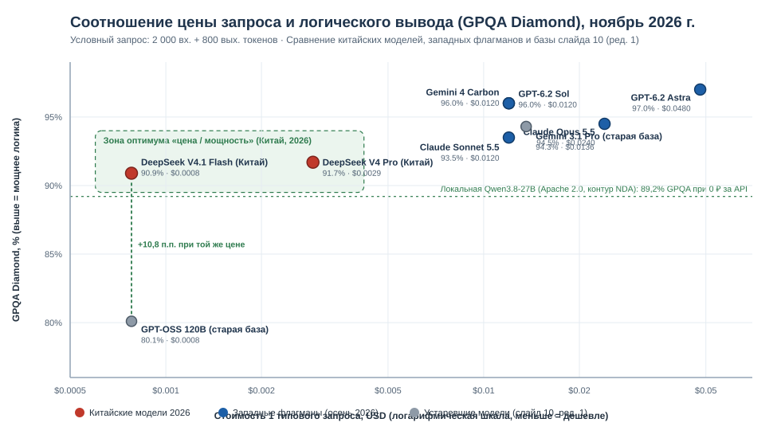
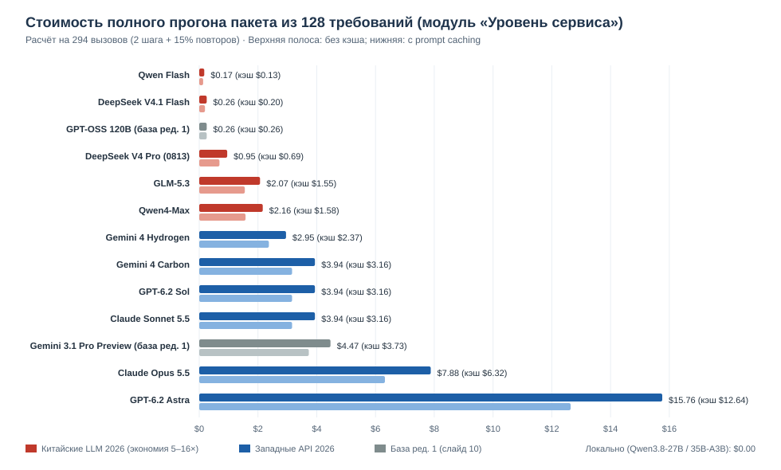

# Анализ «цена — качество» и экономическое обоснование (ноябрь 2026 г.)

## 1. Методика расчёта затрат

Для сопоставления моделей на единой нагрузке используются два сценария:

1. **Условный одиночный запрос:**
   $$C_{\text{запрос}} = \frac{2000 \cdot P_{\text{вх}} + 800 \cdot P_{\text{вых}}}{10^6}$$
   где $P_{\text{вх}}$ и $P_{\text{вых}}$ — публичные тарифы в USD за 1 млн токенов.

2. **Полный прогон модуля «Уровень сервиса» (128 требований ТЗ):**
   - Двухшаговый конвейер (`2 × 128 = 256` вызовов) + `15%` автоповторов валидатора = **`294` вызова**.
   - Структура каждого вызова: `1 400` токенов стабильного системного промпта и few-shot эталона (кэшируемый префикс), `800` токенов текста требования, `900` токенов структурированного JSON-выхода с шагами Test IT.

## 2. Эффект prompt caching и преимущество китайских моделей

В конвейере генерации тест-кейсов доля повторяемого системного промпта и эталонов составляет около **63%** всего входного объёма (`1 400 / 2 200` токенов). Современные API глубоко дисконтируют попадания в кэш (cache hit):
- У **`DeepSeek V4.1 Flash`** чтение из кэша стоит **`$0,003` за 1 млн токенов** (скидка **98%** к базовому входу `$0,15`), что снижает стоимость обработки всех 128 требований с `$0,26` до **`$0,20`**.
- У **`DeepSeek V4 Pro`** стоимость пакета 128 требований с кэшем составляет **`$0,69`**, у **`Qwen4-Max`** — **`$1,58`**.
- На западных моделях среднего и флагманского уровней (`Gemini 4 Carbon`, `GPT-6.2 Sol`, `Claude Sonnet 5.5`) аналогичный прогон с кэшем обходится в **`$3,16`**, а на топ-флагманах (`Claude Opus 5.5`, `GPT-6.2 Astra`) — в **`$6,32–$12,64`**.

Таким образом, китайские облачные модели обеспечивают **экономию в 5–16 раз** относительно сопоставимых по классу западных решений.

## 3. Графики анализа

### 3.1. Позиционирование по стоимости запроса и GPQA Diamond

### 3.2. Сравнение затрат на пакет из 128 требований

## 4. Методологические оговорки (честность сравнения)

1. Опубликованные метрики (`GPQA Diamond`, `DeepSWE`, `SWE-bench`, `Terminal-Bench`) получены производителями на собственных оценочных стендах (different scaffolds / thinking effort) и служат **верхнеуровневым ориентиром**, а не заменой внутреннего тестирования на ТЗ ООО «АшанТех».
2. Для задач генерации тест-кейсов на русском языке критичны три доменных свойства, не измеряемых напрямую в GPQA: строгое сохранение индексов UI (например, `1.4.3.1`), соблюдение ролевой изоляции (8 ролей) и отказ от додумывания при пробелах ТЗ (`needs_clarification`).
3. С ростом качества открытых моделей (`Qwen3.8-27B` — `89,2% GPQA`, `>91% IFEval`) разрыв между локальной бесплатной моделью и облачными API сократился до единиц процентов, что делает локальный NDA-контур полноценно конкурентоспособным.
